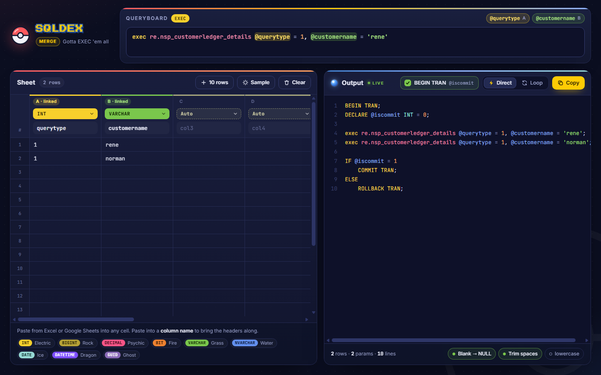

# SQLDex Merge

Write a T-SQL query once, paste your rows from Excel or Google Sheets, and get a ready-to-run script.



## Features

- **Queryboard.** Type any T-SQL: `EXEC`, `SELECT`, `INSERT`, `UPDATE`, `DELETE`, or a multi-statement script. Every `@param` becomes a column in the sheet.
- **Two-way sync.** Typing a `@param` names a column, and renaming a column renames the `@param` in the query.
- **Spreadsheet-style sheet.** Up to 10 columns. Paste a block of cells straight from Excel or Google Sheets, with or without headers.
- **Column types.** *Auto* detects the type from the data, or you can pick INT, BIGINT, DECIMAL, BIT, VARCHAR, NVARCHAR, DATE, DATETIME or GUID. Cells that don't match their type turn red.
- **Safe values.** Quotes are escaped, Unicode text gets `N'...'`, and blank cells become `NULL`.
- **Two output modes.**
  - **Direct** writes one statement per row.
  - **Loop** loads the rows into a table variable and runs the query in a `WHILE` loop.
- **BEGIN TRAN with `@iscommit`.** Wraps the script so the first run rolls back and you can check the result before committing.
- **Live preview and one-click copy.**
- **Nothing to install.** It runs in the browser, works offline, and keeps your last session in the browser's local storage.

## Getting started

```sh
git clone https://github.com/pauljohnfabic/sqldex-merge.git
```

Open `index.html` in any modern browser (Chrome, Edge or Firefox). There's no build step and no server.

## How to use

1. **Type your query in the Queryboard.** For example:

   ```sql
   delete from re.customerledger where transactionno = @docno
   ```

   Column A of the sheet is named `docno`.

2. **Paste your data** into the sheet, one row per execution.
3. **Check the type** above each column. *Auto* is usually right. Pick a type to override it.
4. **Choose Direct or Loop**, then click **Copy**.
5. **Run the script in SSMS.** With BEGIN TRAN on, the first run rolls back. When the result looks right, change `@iscommit` to `1` and run it again to commit.

### What the Queryboard understands

| You type | The sheet |
|---|---|
| `delete from re.customerledger where transactionno = @docno` | Column A is named `docno`. |
| `exec re.nsp_customerledger @qtype = 1` | Column A is named `qtype`, and row 1 gets `1`. |
| `re.nsp_customerledger` (procedure name only) | Every named column is passed as `@column = value`. |
| `exec re.nsp_x @transno = @docno` | The `docno` column fills `@transno`. |

The procedure-name-only form also works the other way around: name the columns (or paste rows with a header line into a column name), then type the procedure name.

Variables you `DECLARE` in the query, and system variables like `@@ROWCOUNT`, are not treated as columns.

### Direct vs Loop

The output for the `delete` example above, with three document numbers in the sheet.

**Direct** writes one statement per row. It's easy to read and best for a handful of rows.

```sql
BEGIN TRAN;
DECLARE @iscommit INT = 0;

delete from re.customerledger where transactionno = 'DOC-0001';
delete from re.customerledger where transactionno = 'DOC-0002';
delete from re.customerledger where transactionno = 'DOC-0003';

IF @iscommit = 1
    COMMIT TRAN;
ELSE
    ROLLBACK TRAN;
```

**Loop** puts the rows in `@tbl` and runs the query once per row, using variables named after the columns. It keeps the script short when there are many rows.

<details>
<summary>Show the Loop output</summary>

```sql
SET NOCOUNT ON;

BEGIN TRAN;
DECLARE @iscommit INT = 0;

DECLARE @tbl TABLE (
    row_no INT IDENTITY(1, 1) PRIMARY KEY,
    docno VARCHAR(50)
);

INSERT INTO @tbl (docno)
VALUES
    ('DOC-0001'),
    ('DOC-0002'),
    ('DOC-0003');

DECLARE @min INT,
        @max INT,
        @docno VARCHAR(50);

SELECT @min = MIN(row_no), @max = MAX(row_no) FROM @tbl;

WHILE @min <= @max
BEGIN
    SELECT @docno = docno
    FROM @tbl
    WHERE row_no = @min;

    delete from re.customerledger where transactionno = @docno;

    SET @min = @min + 1;
END

IF @iscommit = 1
    COMMIT TRAN;
ELSE
    ROLLBACK TRAN;
```

</details>

`INSERT` statements are split every 1,000 rows, which is SQL Server's limit for one `VALUES` list.

### BEGIN TRAN and @iscommit

The **BEGIN TRAN @iscommit** checkbox next to Direct / Loop is on by default. It wraps the script in a transaction that rolls back unless `@iscommit = 1`.

Turn it off for:

- statements that can't run inside a transaction, such as `RESTORE DATABASE`;
- scripts that contain `GO`, because `GO` ends the batch and `@iscommit` stops existing after it.

## Value rules

| Type | How a cell is written |
|---|---|
| INT, BIGINT, DECIMAL | As a number. Thousands separators are removed (`1,250.50` becomes `1250.50`). |
| BIT | `1`, `true`, `yes`, `y` become `1`. `0`, `false`, `no`, `n` become `0`. |
| VARCHAR, DATE, DATETIME, GUID | Quoted, with `'` escaped as `''`. |
| NVARCHAR | Quoted as `N'...'`. |
| Any type | A blank cell or the word `NULL` becomes `NULL`. |

*Auto* keeps values with leading zeros, like `007`, as text.

## Sheet tips

- `Enter` / `Shift+Enter` move down and up. The arrow keys move between cells.
- Paste into a **column name** cell to bring the header line along with the data.
- Hover over a column header for **Fill blanks down** and **Clear column data**.
- Paste, Clear, Sample, Fill blanks down and Clear column data can each be undone from the message that pops up afterwards.

## Options

These are at the bottom of the Output panel.

| Option | What it does |
|---|---|
| Blank → NULL | Blank cells become `NULL`. Turn it off to write blank text cells as `''`. |
| Trim spaces | Removes leading and trailing spaces from every value. |
| lowercase | Writes the keywords that SQLDex generates in lowercase. |

## Development

The SQL engine has unit tests (Node 18 or newer):

```sh
npm test
```

| Path | Contents |
|---|---|
| `index.html` | The page |
| `css/styles.css` | The theme |
| `js/engine.js` | Query parsing, sheet ⇄ query sync and SQL generation. It has no DOM code, so it runs in Node too. |
| `js/app.js` | The UI |
| `tests/engine.test.js` | Engine tests |

Plain HTML, CSS and JavaScript, with no framework and no dependencies.
